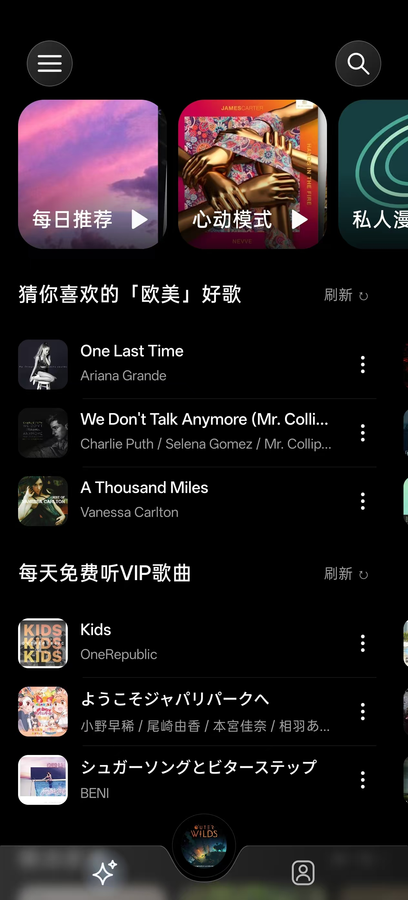
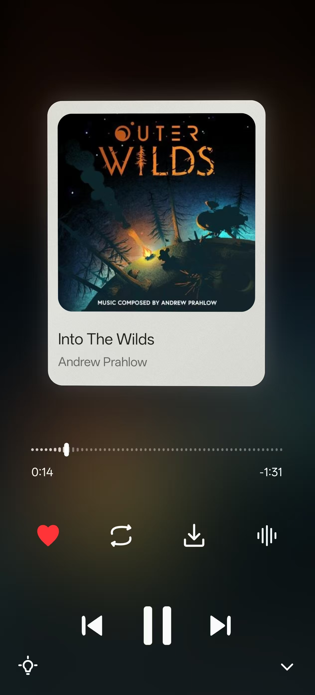
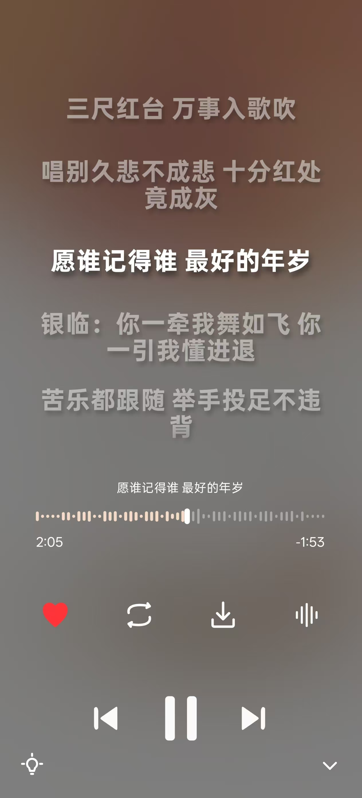
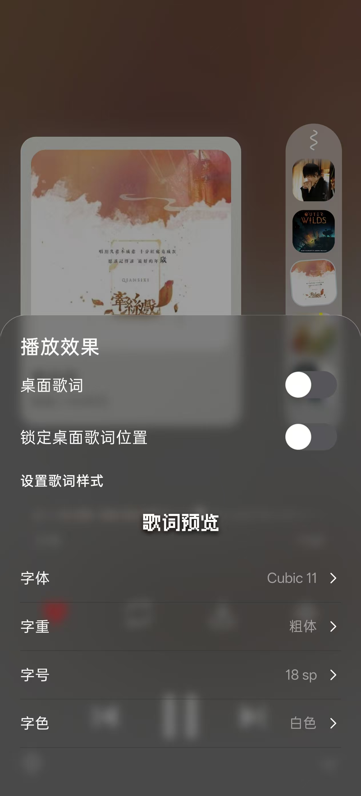

# Doto Android

Doto 的独立 Android 原生音乐播放器，使用 Java 和 Android 原生组件。项目包含本地曲库、播放队列、歌词、在线音乐入口和端侧音频分轨源码。

## 应用截图







## 构建

安装 Android SDK，在项目根目录运行：

```powershell
.\gradlew.bat :app:assembleDebug
```

APK 输出到 `app/build/outputs/apk/debug/`。可通过 `ANDROID_HOME` 或本机的 `local.properties` 配置 SDK 路径。

分轨所需模型单独提供。持有可用模型时，运行 `node scripts/prepare-assets.mjs <模型文件路径>`，脚本会校验 SHA-256 并准备分轨模型及合成测试音频。
